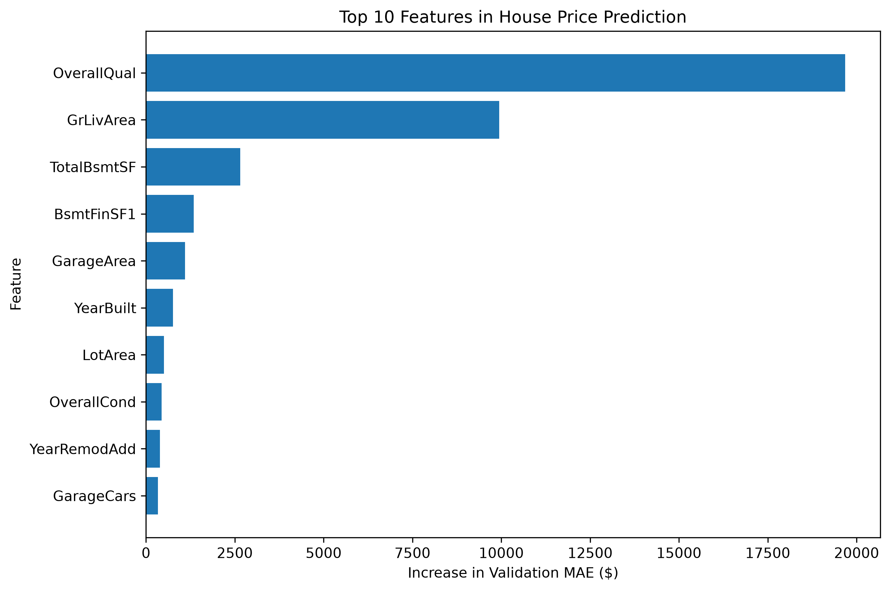

# House Price Prediction Using Machine Learning

A beginner machine learning project that predicts house sale prices using housing features from the Kaggle House Prices competition dataset.

## Project Overview

The goal of this project is to build a regression model that estimates house sale prices using information such as overall quality, living area, basement size, garage features, and year built.

This project was developed in Python using Jupyter Notebook in Visual Studio Code.

## Technologies Used

- Python
- Pandas and NumPy
- Matplotlib
- Scikit-learn
- Jupyter Notebook
- Visual Studio Code

## Dataset

The dataset comes from the [Kaggle House Prices competition](https://www.kaggle.com/competitions/house-prices-advanced-regression-techniques).

The original training dataset contains 1,460 records and 81 columns, including the target variable `SalePrice`.

**Target variable:** `SalePrice`

## Project Workflow

1. **Data exploration:** Inspected the dataset structure, data types, missing values, and sale-price distribution.
2. **Exploratory data analysis:** Examined relationships between sale prices, overall quality, and living area.
3. **Outlier investigation:** Examined houses with unusually large living areas. Two observations matching the project's chosen outlier rule were excluded from the initial working dataset.
4. **Feature preparation:** Removed the `Id` column and separated the target variable from the input features.
5. **Missing-value handling:** Filled missing numerical values using the median and missing categorical values using the most frequent value.
6. **Categorical encoding:** Used One-Hot Encoding to convert categorical features into numerical representations.
7. **Model training:** Trained a Random Forest Regressor.
8. **Model evaluation:** Compared the model against a simple baseline and evaluated performance using Mean Absolute Error (MAE) and five-fold cross-validation.
9. **Feature importance:** Used permutation importance to investigate which features contributed most to predictive performance.

## Model and Results

The final model configuration used in the validation experiment was:

- Model: Random Forest Regressor
- Number of trees: 100
- Maximum tree depth: 20
- Minimum samples per leaf: 1
- Training/validation split: 80% / 20%

### Evaluation Results

| Evaluation | MAE |
|---|---:|
| Median baseline | $57,100.22 |
| Random Forest with numerical features | $17,371.09 |
| Random Forest with numerical and categorical features | $16,969.75 |
| Average five-fold cross-validation MAE | $17,251.96 |

Lower MAE indicates smaller average absolute prediction errors.

Adding categorical features reduced validation MAE by approximately 2.31% compared with the numerical-only model.

The five-fold cross-validation MAE provides an additional estimate of model performance across different data splits.

## Feature Importance

Permutation importance on the validation dataset identified the following as the most influential features:

1. `OverallQual` — overall material and finish quality.
2. `GrLivArea` — above-ground living area.
3. `TotalBsmtSF` — total basement area.
4. `BsmtFinSF1` — area of type 1 finished basement.
5. `GarageArea` — garage size.

These importance scores measure how much validation performance worsened when each feature was shuffled. They do not establish causation.

## Limitations

- The model was developed as a learning project, not as a professional property valuation tool.
- The outlier exclusion rule was a heuristic decision and needs further evaluation.
- Predictions can be inaccurate for individual houses, particularly those with unusual combinations of features.
- Cross-validation and validation scores do not guarantee the same performance on new data.

## Future Improvements

- Compare Random Forest with other regression models.
- Experiment with additional feature engineering.
- Tune model hyperparameters more systematically.
- Investigate large prediction errors.
- Evaluate the model on unseen competition test data.
- Develop a simple interface for making predictions on new house details.

## What I Learned

Through this project, I practised data exploration, missing-value handling, categorical encoding, model training, validation, cross-validation, error analysis, and feature importance.

This project is part of my ongoing journey to develop practical machine learning and AI skills.